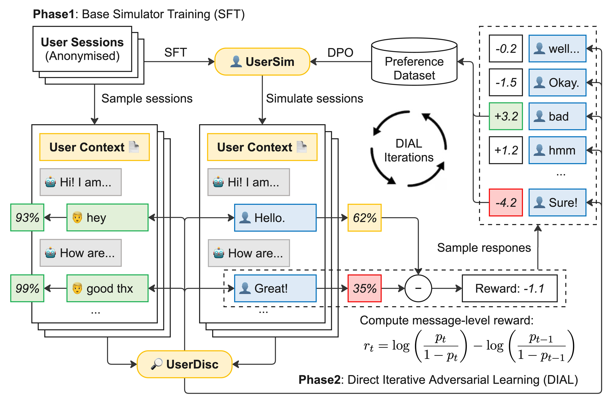

# DIAL: Direct Iterative Adversarial Learning for Realistic Multi-Turn Dialogue Simulation

[](https://aclanthology.org/2026.findings-emnlp.46/)

Code for the Findings of EMNLP 2026 paper:

> **DIAL: Direct Iterative Adversarial Learning for Realistic Multi-Turn Dialogue Simulation**
> Ziyi Zhu, Olivier Tieleman, Caitlin A. Stamatis, Luka Smyth, Thomas D. Hull, Daniel Reid Cahn, Jinghong Chen, Matteo Malgaroli
> *Findings of the Association for Computational Linguistics: EMNLP 2026*, pages 925–942.
> [[Paper]](https://aclanthology.org/2026.findings-emnlp.46/) [[PDF]](https://aclanthology.org/2026.findings-emnlp.46.pdf)

<p align="center">
  
</p>

## Abstract

Realistic user simulation is crucial for training and evaluating multi-turn dialogue systems, yet creating simulators that accurately replicate human behavior remains a significant challenge. An effective simulator must expose the failure modes of the systems under evaluation. This work introduces Direct Iterative Adversarial Learning (DIAL), an adversarial framework that iteratively enhances user simulator realism through a competitive dynamic between a generator (user simulator) and a discriminator. When applied to mental health support, a domain characterized by diverse failure types and a critical dependence on realistic user behavior for failure detection, DIAL restores lexical diversity diminished by supervised fine-tuning and drastically reduces discriminator accuracy. The resulting simulator exhibits a strong correlation between simulated and real failure occurrence rates while maintaining low distributional divergence of failure modes. These findings indicate that DIAL is a promising method for developing realistic user simulators in multi-turn dialogue, facilitating reliable and cost-effective system evaluation prior to deployment.

## Method

DIAL trains a user simulator (US) against a learned discriminator with direct preference optimisation (DPO). Each round:

1. **Simulate**: the current US talks to a response generator (RG).
2. **Discriminate**: a token-classification discriminator learns to tell real from simulated user turns.
3. **Score**: the discriminator's log-odds delta gives a reward for every simulated turn.
4. **Regenerate and rank**: the lowest-reward turns are regenerated several times and ranked into (chosen, rejected) pairs.
5. **DPO**: the US is fine-tuned on these pairs and becomes the next round's simulator.

The paper applies DIAL to mental-health dialogue. This repository reproduces the procedure on **MultiWOZ 2.1**, a public task-oriented benchmark.

## Installation

```bash
git clone https://github.com/slingshot-ai/dial.git
cd dial
git clone https://github.com/ConvLab/ConvLab-3.git   # MultiWOZ 2.1, baseline simulators and evaluator
pip install -e ConvLab-3
pip install torch transformers datasets peft bitsandbytes accelerate scikit-learn numpy tqdm wandb \
    together litellm openai mauve-text
```

Training the 8B discriminator (4-bit, LoRA) needs a GPU with at least 24 GB of memory. SFT and DPO of the 70B simulator run on Together AI. Set the API keys:

```bash
export TOGETHER_API_KEY=...      # SFT, DPO and inference
export OPENROUTER_API_KEY=...    # for openrouter/* models
export OPENAI_API_KEY=...        # MAUVE embeddings
export HF_TOKEN=...              # pushing datasets to the Hugging Face Hub
export WANDB_API_KEY=...         # optional logging
```

## Usage

Model and dataset names are set by the constants at the top of each script. They default to the `slingshot/` namespace on the Hugging Face Hub and include the iteration index (`it1`, `it2`, ...).

**Phase 1: supervised fine-tuning.** Build SFT datasets for the US and the RG from the MultiWOZ 2.1 train split, then fine-tune Llama-3.1-70B-Instruct on each:

```bash
python generate_sft_datasets.py    # override the target repos with HF_REPO_US / HF_REPO_RG
python launch_sft_us.py
python launch_sft_rg.py
```

The LLM US ends a dialogue by emitting a literal `[END]`; the dataset builders add it to every ground-truth dialogue so SFT matches inference.

**Phase 2: DIAL.** Repeat for each iteration, pointing the scripts at the current checkpoints:

```bash
python generate_discriminator_data.py   # real validation dialogues paired with simulated ones
python train_discriminator.py           # token classification on Llama-3.1-8B-Instruct, labels at each US end-of-turn
python generate_preference_dataset.py   # score turns, regenerate the two lowest-reward turns 8 times, form pairs
python launch_dpo_us.py --filter-chosen-rejected --top-margin-frac 1.0 --dpo-beta 1.0
```

<details>
<summary>DPO arguments</summary>

| Argument | Description | Default |
| :-- | :-- | :-- |
| `--filter-chosen-rejected` | Drop pairs whose chosen and rejected turns are identical | off |
| `--top-margin-frac` | Keep this fraction of pairs with the largest reward margin | 1.0 |
| `--dpo-beta` | DPO temperature β | 1.0 |
| `--learning-rate` | Peak learning rate | 1e-6 |
| `--n-epochs` | Epochs over the preference dataset | 1 |

</details>

### Evaluation

Evaluate baseline simulator and system pairs on the MultiWOZ 2.1 test set:

| Combination | User simulator | System |
| :-- | :-- | :-- |
| `rule_us_rule_sys` | Rule | Rule |
| `tus_rule_sys` | TUS | Rule |
| `gentus_rule_sys` | GenTUS | Rule |
| `llm_us_llm_rg` | LLM US | LLM RG |
| `llm_us_rule_sys` | LLM US | Rule NLU + policy + NLG |

```bash
python run_baselines.py        # results in experiment_results/<combination>/
python run_custom_models.py    # DIAL-trained US (and optionally RG)
python compute_diversity.py    # TTR, distinct-n, entropy, lengths and MAUVE against human turns
```

Every long-running step caches per-dialogue results (`cache/baselines/`, `cache/discriminator/`, `cache/preference/`, `.mauve_cache/`), so reruns only compute what is missing. `python remove_empty_cache.py` removes entries from failed runs (`--dry-run` to preview).

## Repository structure

```
generate_sft_datasets.py         US and RG SFT datasets from MultiWOZ 2.1
launch_sft_us.py, launch_sft_rg.py
generate_discriminator_data.py   real and simulated dialogues for the discriminator
train_discriminator.py           token-classification discriminator (LoRA)
generate_preference_dataset.py   turn rewards, regeneration and preference pairs
launch_dpo_us.py                 DPO of the US on Together AI
run_baselines.py                 baseline evaluation
run_custom_models.py             evaluation of DIAL-trained models
compute_diversity.py             lexical diversity and MAUVE
remove_empty_cache.py            cleanup of failed cache entries
```

## Citation

```bibtex
@inproceedings{zhu-etal-2026-dial,
    title = "{DIAL}: Direct Iterative Adversarial Learning for Realistic Multi-Turn Dialogue Simulation",
    author = "Zhu, Ziyi  and
      Tieleman, Olivier  and
      Stamatis, Caitlin A.  and
      Smyth, Luka  and
      Hull, Thomas D.  and
      Cahn, Daniel Reid  and
      Chen, Jinghong  and
      Malgaroli, Matteo",
    editor = "Lee, Hung-Yi  and
      Dev, Sunipa  and
      Li, Jessy  and
      Elliott, Desmond",
    booktitle = "Findings of the {A}ssociation for {C}omputational {L}inguistics: {EMNLP} 2026",
    month = oct,
    year = "2026",
    address = "Budapest, Hungary",
    publisher = "Association for Computational Linguistics",
    url = "https://aclanthology.org/2026.findings-emnlp.46/",
    pages = "925--942",
    ISBN = "979-8-89176-462-0",
}
```

## Acknowledgments

DIAL builds on [ConvLab-3](https://github.com/ConvLab/ConvLab-3) for MultiWOZ 2.1, the baseline simulators (rule, TUS, GenTUS), the LLM agent wrappers and the evaluator. Fine-tuning runs on [Together AI](https://together.ai/), and MAUVE uses the [`mauve-text`](https://github.com/krishnap25/mauve) package.

## License

Apache-2.0. See [LICENSE](LICENSE).
